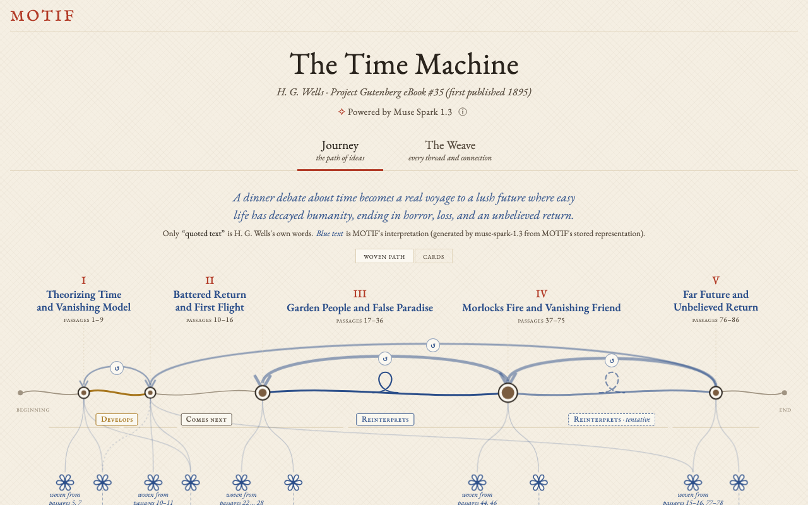
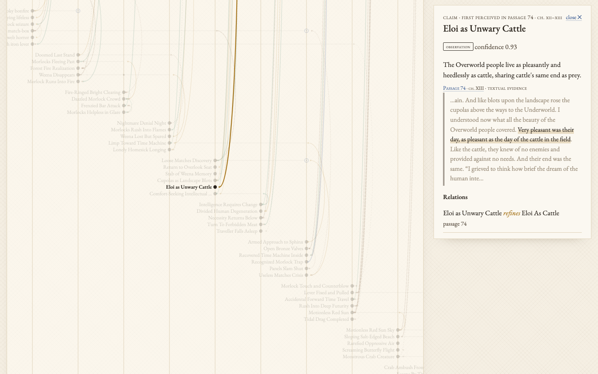

# MOTIF

**See how the meaning of a book changes as you read it.**

MOTIF (Meaning-Oriented Text Interrelationship Framework) reads a text passage by passage, in order, and builds a
persistent memory of its ideas: what each passage says, how it connects to what came before, which earlier readings it
revises, and which larger meanings emerge from several moments together. Every link stays tied to the exact words in the
text that support it.

The memory is called **MORe** (Meaning-Oriented Representation), and MORe is also the name of the engine that builds
it. The language model is Meta's **Muse Spark 1.3**, accessed through the Meta Model API. MOTIF and MORe were built for
the Meta Global AI Developer Hackathon.

The repository contains the saved Muse Spark 1.3 results for three texts: Plato's *Allegory of the Cave*, O. Henry's
*The Gift of the Magi* and H. G. Wells's complete *The Time Machine*. **You can run the app, explore the results and
replay every model run without a Meta API key and without making any API calls.**



## Architecture: Process Once, Explore Many Times

```
Book text ──▶ MORe + Muse Spark 1.3 ──▶ Stored representation ──▶ MOTIF reader
              preprocessing, run once        units, relations, revisions,      Journey and The Weave,
              per book by a developer        constructed meanings, Journey,    explored by readers with
              or publisher                   evidence (SQLite)                 no LLM calls
```

MOTIF is designed around **processing books ahead of time, on the server side**, not around readers uploading books.

**MORe, the book processing engine.** A developer or publisher supplies the text of a book and runs MORe as a backend
task. MORe reads the book incrementally with Muse Spark 1.3. It builds and revises evidence-linked units and relations,
constructs higher-level meanings, synthesizes the Journey, and stores all of it. This is done once per book, and the
result can be reused by every reader of that book.

**MOTIF, the reader-facing application.** A reader selects a book that has already been processed and explores its
Journey of Ideas and The Weave. The application reads the stored representation and makes no LLM calls during ordinary
exploration. It is intentionally not designed around readers uploading and processing their own books.

**Intended use (future potential, not implemented).** MOTIF is meant as a technology that could be integrated into an
ebook platform, a digital library, an educational reading environment or a literary research application. In such a
deployment, the platform operator would process books on its servers, store the representations and serve them to
readers, who would explore each book's evolving meanings and connections. Inference costs would be incurred once,
during preprocessing, rather than in every reading session. No such integration or production processing service
exists yet.

**What this hackathon prototype provides:**

- a working command-line MORe processing pipeline that uses Muse Spark 1.3
  ([Process a book with MORe](#process-a-book-with-more));
- persistent, evidence-linked representations stored in SQLite;
- saved model results, including the cache of every model response, for three literary texts
  ([Saved results](#saved-results));
- a read-only API that serves the saved representations;
- the interactive Journey and The Weave reader interface.

The prototype has no book-upload interface; the intended reader experience does not need one.

## The reader interface

**Journey** (the default view) is the path of ideas through the whole book: 4 to 6 stages, each with a title, a
one-sentence summary and the reason it leads to the next. The form of the thread shows the kind of move between stages
(development, reinterpretation, contradiction, consequence, analogy, succession). Arcs mark returns to earlier ideas, and
small knots mark *constructed meanings*. Selecting a stage shows what is understood there, the quotations behind it, and
links into The Weave.

**The Weave** is the detailed research view. Columns are passages in reading order. Threads are the units of meaning
MOTIF perceived, from the passage that introduced them to the last one that returned to them. Loops are the relations
between units, tied at the passage where they were formed. Selecting anything opens the evidence: the verbatim
quotation in context, the model's rationale, and the full history of how that unit's reading was revised.



Only text in quotation marks is the author's. Text in blue is generated interpretation.

## How it works

```
text → passages (about 300 words, paragraph-aligned)

for each passage, in reading order (nothing from later passages is ever used):
  PERCEIVE    Muse Spark   elementary units: claims, events, concepts, images…, each anchored to a quotation
  GROUND      code         the quotation must occur verbatim in the passage, or the unit is rejected
  ACTIVATE    code         working memory: which earlier units does this passage bring back to mind?
  INTEGRATE   Muse Spark   proposes links, merges and revised readings; code validates every id and rule
  PROPAGATE   Muse Spark   reconsiders the direct neighbours of a unit that just changed (one level only)
  CONSTRUCT   Muse Spark   builds a higher-level meaning from two or more units, when a trigger rule fires
  → SQLite

JOURNEY       Muse Spark   synthesizes 4 to 6 stages from the stored representation (never the source text)
EXPLAIN       Muse Spark   classifies each move between stages; code checks the evidence can show that kind
```

Every Muse Spark 1.3 call uses structured output (a JSON schema per task) on the Meta Model API's OpenAI-compatible
Chat Completions endpoint, at medium reasoning effort. The model proposes; deterministic code decides what is stored.

## Main technical contribution

MORe treats reading as **incremental, evidence-grounded memory construction**, not as summarization of a whole text.

1. **Reading order is enforced.** Each passage is processed once, in order. The model sees only the earlier units that
   working memory recalls, and code rejects any link to a unit outside it. Without this rule the "emergence" of meaning
   would be the model reading the whole book at once.
2. **Fixed content, revisable reading.** A unit's content never changes once it is grounded in a quotation. What it
   *signifies* can be revised by later passages, and every revision is logged with the passage, the old and new
   reading, the rationale and the unit that caused it. A change in the story (`CHANGES_STATE`) is kept apart from a
   change in interpretation, so a plot development is not mislabelled as a contradiction.
3. **Constructed meanings.** A higher-level meaning, such as the mutual sacrifice in *The Gift of the Magi*, is built from
   two or more unchanged units. It records its contributors and their roles, verbatim quotations from passages already
   read, and whether it is explicit in the text or inferred. Code rejects speculative or ungrounded proposals,
   consolidates repeats, and holds ambiguous ones as *pending* until later evidence confirms them.
4. **The model proposes, code verifies.** Quotations are checked verbatim, ids and relation types are validated, and
   an "explicit" basis requires the exact words that state the meaning.
5. **Deterministic replay.** Every model response is cached under a hash of the full request. Given the saved
   responses, the pipeline rebuilds every representation bit for bit with the API unreachable (see
   [Reproduce the model runs offline](#reproduce-the-model-runs-offline)).

The design notes for each step are in [`docs/experiments/`](docs/experiments/) and
[`docs/design/journey-visual.md`](docs/design/journey-visual.md).

## Saved results

All three were produced by Muse Spark 1.3 (Standard mode) with the same pipeline.

| Text | Passages | Units | Relations | Revisions | Constructed meanings | Database |
|---|---:|---:|---:|---:|---:|---|
| Plato, *The Allegory of the Cave* | 9 | 46 | 69 | 20 | 11 | `data/motif.m51.db` |
| O. Henry, *The Gift of the Magi* | 6 | 31 | 46 | 8 | 6 | `data/motif.m51.db` |
| H. G. Wells, *The Time Machine* (complete, 32,310 words, 17 chapters) | 86 | 463 | 668 | 175 | 92 | `docs/experiments/time_machine/exports/motif.the_time_machine.db` |

The Time Machine run took 311 model calls and cost $6.34
([report](docs/experiments/time_machine/REPORT.md)). Each database holds the representation, the Journey with its
transition explanations, the usage log, and the cache of every model response. Their SHA-256 checksums are in
[`data/SAVED_RESULTS.sha256`](data/SAVED_RESULTS.sha256). The Time Machine results are also exported as plain JSON in
[`docs/experiments/time_machine/exports/`](docs/experiments/time_machine/exports/), including every model request and
response (`model_calls.jsonl.gz`).

## Run the app with the saved results (no Meta API calls)

Requirements: Python 3.11 or newer with [uv](https://docs.astral.sh/uv/), and Node.js 20 or newer with npm.

**1. Backend.** From the repository root:

```bash
cd backend
uv sync                                    # install Python dependencies from uv.lock

# Combine the three saved books into one database for the app. Rows are copied, nothing is generated,
# and the saved databases are only read.
uv run python ../scripts/make_offline_db.py ../data/motif.offline.db

MOTIF_DB=../data/motif.offline.db uv run uvicorn motif.api:app --port 8000
```

The API is read-only: it serves stored data and has no route that calls the model, so browsing can never spend API
credits. No `.env` file or API key is needed. Point the app at the combined copy, not at the saved databases
themselves, which are kept unchanged for the replay checks.

**2. Frontend.** In a second terminal:

```bash
cd frontend
npm ci                                     # install exact versions from package-lock.json
npm run dev                                # http://localhost:5173, proxies /api to the backend on :8000
```

Open <http://localhost:5173/?book=the_time_machine>. The book selector at the top right switches between the three
texts, and the tabs switch between Journey and The Weave.

The fonts (EB Garamond and IM Fell English SC) load from Google Fonts. Without internet access, the browser falls back
to a local serif font.

## Run the tests

```bash
cd backend  && uv run pytest -q            # 109 passed, 1 skipped
cd frontend && npm test                    # 56 passed
cd frontend && npm run build               # production build
```

The skipped backend test checks a local model run in `data/motif.db`, which is not part of the repository.

## Reproduce the model runs offline

These scripts rebuild every representation from the cached Muse Spark responses with **the current code**, with the
API pointed at a dead address, and compare the result with what is stored. Any call missing from the cache would
fail loudly instead of reaching the network. Both work on temporary copies and modify nothing.

```bash
cd backend
# Plato and The Gift of the Magi: every table compared row by row
uv run python ../docs/experiments/time_machine/scripts/rebuild_existing_books_check.py
#   → ALL IDENTICAL, ZERO API REQUESTS

# The Time Machine: rebuilt passage by passage and compared with the 86 stored checkpoints
uv run python ../docs/experiments/time_machine/scripts/offline_rebuild_check.py
#   → "identical_to_stored_checkpoints": 86, "mismatches": 0, "api_requests_attempted": 0
```

(The `spend_usd` value that the second script prints is the cost of the original run, read from its usage log.)

A *new* run against the live API is not byte-for-byte reproducible, because the model samples its responses. That is
why the responses are saved and replayed.

## Process a book with MORe

This is the preprocessing step of the architecture above: a developer runs it once per book, and the reader
application then serves the stored result. It calls Muse Spark 1.3, so it needs an API key from
<https://dev.meta.ai>. Copy `.env.example` to `.env` and set `MODEL_API_KEY`. The `.env` file is gitignored.

To add a book, put its plain text in `data/texts/<id>.txt` and its metadata in `data/texts/<id>.json`, following the
existing files, for example:

```json
{"id": "my_book", "title": "My Book", "author": "Author Name", "genre": "fiction", "text_file": "my_book.txt"}
```

Then process it (shown here for `plato_cave`):

```bash
cd backend
uv run python -m motif.cli check                          # verifies the key and model (free)
uv run python -m motif.cli process plato_cave --limit 2   # try two passages first
uv run python -m motif.cli process plato_cave             # resumes; finished passages are skipped
uv run python -m motif.cli journey plato_cave             # synthesize the Journey
uv run python -m motif.cli explain plato_cave             # explain the transitions
uv run python -m motif.cli usage                          # tokens and cost per call
uv run uvicorn motif.api:app --port 8000                  # serve data/motif.db to the reader application
```

**Cost controls.** Every call is logged with its input, cached, output and reasoning tokens and its cost. Before each
request the client estimates the worst case and refuses to send if total recorded spend would exceed
`MOTIF_BUDGET_USD` (default $2). Failed calls are not retried automatically, and cached responses cost nothing.

**Hand-authored demo.** `process plato_cave --offline --reset` runs the pipeline on a hand-written fixture
(`data/demo/`, *not* model output), and `MOTIF_DEMO=1 uv run uvicorn motif.api:app` serves it with a red
"Demonstration data" banner. The saved Muse Spark results above are real model output and are labelled as such.

## Repository layout

```
backend/motif/        the pipeline: text, perceive, activation, integrate, propagate, construct,
                      journey, explain, graph, store, llm (Meta Model API client and cache), api, cli
backend/tests/        pytest suite
frontend/src/         React + TypeScript: JourneyWoven (Journey), Loom (The Weave), Inspector (evidence)
data/texts/           the source texts and their metadata
data/motif.m51.db     saved results for Plato and The Gift of the Magi
data/results/         earlier saved runs (Day 1 and Day 2 baselines, JSON)
data/demo/            hand-authored offline fixture (not model output)
docs/experiments/     one folder per experiment: expectations written before the run, raw requests and
                      responses, usage, logs and a REPORT.md (time_machine/ is the full-book run;
                      its findings/ holds the strongest discoveries and the Eloi verification)
docs/design/          design of the Journey visualization (its evaluation screenshots: docs/screenshots/m6/)
docs/images/          the screenshots in this README
scripts/              make_offline_db.py: combines the saved databases for the app
```

## Limitations

MOTIF is an experimental prototype, and its findings are indicative.

- Each passage was processed with one Muse Spark sample. The interpretive quality was judged by one rater against
  expectations written before the run; there has been no validation study.
- Working-memory recall is lexical (word overlap plus salience), so it can miss links a human reader would make.
- Segmentation is by paragraph groups of about 300 words and has no notion of argument structure.
- In *The Time Machine*, the reading of the Eloi as "cattle" is the Traveller's own, stated in Chapter XIII. MOTIF
  traces how that reading forms, step by step and with evidence; it does not discover it.
- The Journey layout falls back to cards below 760 px wide; there is no phone layout.

## Texts and attribution

| Text | Status | Source |
|---|---|---|
| Plato, *The Republic*, opening of Book VII, translated by Benjamin Jowett (1871) | Public domain | [Project Gutenberg #1497](https://www.gutenberg.org/ebooks/1497) |
| O. Henry, *The Gift of the Magi* (1905) | Public domain | [Project Gutenberg #7256](https://www.gutenberg.org/ebooks/7256) |
| H. G. Wells, *The Time Machine* (1895) | Public domain | [Project Gutenberg #35](https://www.gutenberg.org/ebooks/35) |
| *The Harlow Footbridge* (`data/texts/synthetic_footbridge.txt`) | Written for this project as a test text | — |

The working copies in `data/texts/` contain only the literary text, with the Project Gutenberg header and footer
removed. The original Project Gutenberg file for *The Time Machine* is kept unmodified, with its license, in
`docs/experiments/time_machine/source/pg35.original.txt`. Readings, units, relations and Journeys in this repository
were generated by Muse Spark 1.3 and are interpretations, not the authors' words.

The interface fonts, EB Garamond and IM Fell English SC, are published under the SIL Open Font License and loaded from
Google Fonts at run time; they are not included in the repository.

## License

MOTIF and MORe are released under the [MIT License](LICENSE). The license covers the source code, tests and
documentation written for this project.

Third-party materials keep their own terms and are not relicensed under MIT:

- **Literary texts.** The three works listed under [Texts and attribution](#texts-and-attribution) are in the public
  domain. `docs/experiments/time_machine/source/pg35.original.txt` is distributed under the Project Gutenberg License it
  contains.
- **Fonts.** EB Garamond and IM Fell English SC are under the SIL Open Font License. They are loaded from Google Fonts
  and not included here.
- **Dependencies.** Python and npm packages are installed by `uv` and `npm` under their own licenses and are not
  included in this repository.
- **Model output.** The saved results were generated with Muse Spark 1.3 through the Meta Model API. Their use may also
  be subject to Meta's terms for that service.
